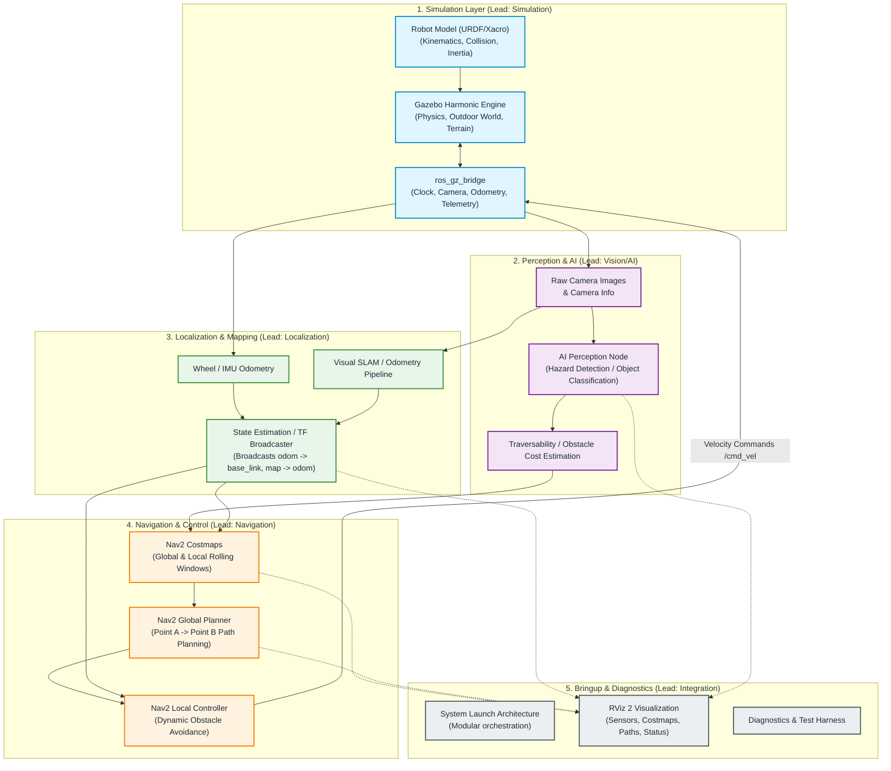

# Trishul UGV Architecture Overview

This document outlines the modular system architecture for the Trishul autonomous UGV. It illustrates the data flow, separation of concerns, and integration points across the 5 core modules.

---

## 1. High-Level Modular Architecture

---

## 2. Package Responsibilities & Boundaries

### 1. `trishul_description`
- **Owner**: Simulation Lead
- **Scope**: Contains 3D meshes, URDF/Xacro descriptions of the UGV chassis, wheels, sensor mounts, and joint kinematics.
- **Rules**: Must strictly define all visual, collision, and inertial properties. Must adhere to REP-103 and REP-105 for joint orientations and link frame names.

### 2. `trishul_simulation`
- **Owner**: Simulation Lead
- **Scope**: Gazebo Harmonic environment worlds (outdoor terrain, obstacles, uneven ground, lighting conditions), launch files for Gazebo Sim, and `ros_gz_bridge` configuration files.
- **Rules**: Responsible for translating Gazebo topics into standard ROS 2 message topics with correct QoS profiles.

### 3. `trishul_perception`
- **Owner**: Vision / AI Lead
- **Scope**: ROS 2 nodes processing camera feeds for object classification, hazard identification, and traversability analysis.
- **Rules**: Must keep inference latency deterministic to prevent lag in costmap updates. Must not directly send velocity commands (`cmd_vel`).

### 4. `trishul_localization`
- **Owner**: Localization Lead
- **Scope**: Spatial state estimation, coordinate frame transformations (`map -> odom -> base_link`), odometry fusion, and investigation/integration of visual SLAM.
- **Rules**: Only one node in the entire system may broadcast a given TF transform link (e.g. `odom -> base_link` or `map -> odom`). Avoid transform loops.

### 5. `trishul_navigation`
- **Owner**: Navigation Lead
- **Scope**: Nav2 configuration (planners, controllers, behavior trees, costmap plugin parameters).
- **Rules**: Subscribes to localization TF and perception obstacle layers; publishes motion commands (`cmd_vel`) to steer the vehicle.

### 6. `trishul_bringup`
- **Owner**: Integration Lead
- **Scope**: Top-level orchestration. Houses top-level launch files that allow booting the entire stack (or specific subsets for testing), centralized RViz 2 profiles, and parameter overrides.
- **Rules**: Does not contain core algorithm logic. Relies on launch inclusions of other packages.
